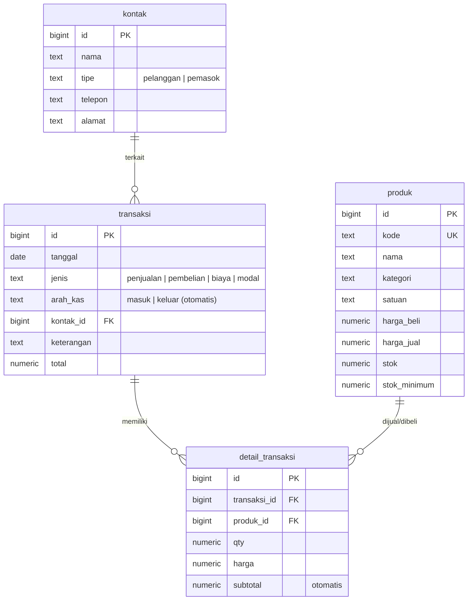

# Toko Tani — Sistem Akuntansi Sederhana

Aplikasi web pembukuan untuk toko pertanian: mencatat penjualan, pembelian stok, biaya, dan modal, lengkap dengan saldo kas, laporan harian, dan peringatan stok menipis.

Dibangun dengan HTML, CSS, dan JavaScript murni di sisi depan, serta **Supabase (PostgreSQL)** di sisi belakang. Tanpa build tool, tanpa `package.json`, tanpa `.env`.

## Fitur

- **Saldo kas** beserta total kas masuk dan kas keluar
- **Laporan harian**: penjualan, pembelian, biaya, dan arus kas bersih per hari
- **Peringatan stok menipis** berdasarkan batas minimum tiap produk
- **Stok otomatis**: penjualan mengurangi stok, pembelian menambah stok (lewat trigger database)
- Penjualan **ditolak** jika stok tidak mencukupi
- Kelola produk, pelanggan, dan pemasok (tambah, ubah, hapus)
- Tampilan responsif untuk desktop dan ponsel

## ERD



Transaksi berjenis **biaya** dan **modal** tidak memiliki detail barang; nilainya langsung disimpan di kolom `total`.

## Struktur Folder

```
toko-tani/
├── backend/
│   ├── schema.sql      # tabel, trigger, fungsi, view laporan, RLS, data contoh
│   └── app.js          # koneksi Supabase dan fungsi akses data
├── frontend/
│   ├── index.html
│   ├── css/
│   │   └── style.css
│   └── js/
│       └── main.js     # logika tampilan
└── README.md
```

## Cara Menjalankan

### 1. Siapkan database

1. Buat proyek di [supabase.com](https://supabase.com).
2. Buka **SQL Editor → New query**.
3. Tempel seluruh isi `backend/schema.sql`, lalu klik **Run**.

> Script diawali perintah `drop ... if exists`, sehingga **semua data lama di keempat tabel akan terhapus** setiap kali dijalankan ulang.

### 2. Hubungkan aplikasi

Buka `backend/app.js`, lalu isi dua baris berikut dengan nilai dari **Project Settings → API**:

```js
const SUPABASE_URL = 'https://PROJECT-ID-ANDA.supabase.co';
const SUPABASE_ANON_KEY = 'ANON-PUBLIC-KEY-ANDA';
```

### 3. Jalankan di komputer

Aplikasi memakai ES Modules, jadi harus dibuka lewat server lokal (bukan klik dua kali pada file).

- **VS Code**: pasang ekstensi *Live Server*, klik kanan `frontend/index.html`, pilih *Open with Live Server*. Buka dari **root folder proyek** agar `frontend/js/main.js` bisa mengimpor `backend/app.js`.
- **Python**: jalankan `python -m http.server 5500` di root proyek, lalu buka `http://localhost:5500/frontend/`.

## Objek Database

| Objek | Fungsi |
|---|---|
| `trg_detail_transaksi` | Trigger: memperbarui stok dan total transaksi saat detail ditambahkan |
| `buat_transaksi(...)` | Fungsi RPC: menyimpan transaksi beserta item dalam satu langkah atomik |
| `v_saldo_kas` | Total kas masuk, kas keluar, dan saldo |
| `v_laporan_harian` | Ringkasan per tanggal |
| `v_stok_menipis` | Produk dengan stok di bawah atau sama dengan batas minimum |

## Catatan Keamanan

Policy Row Level Security pada `schema.sql` mengizinkan akses penuh untuk role `anon` agar mudah dicoba. **Jangan dipakai apa adanya di produksi.** Sebelum dipublikasikan:

1. Aktifkan [Supabase Auth](https://supabase.com/docs/guides/auth) dan tambahkan halaman login.
2. Ganti policy `akses_anon` dengan policy untuk role `authenticated`.
3. Ingat bahwa `SUPABASE_ANON_KEY` terlihat di sisi browser. Keamanan data bergantung pada RLS, bukan pada kerahasiaan key.

## Keterbatasan

- Menghapus transaksi **tidak** mengembalikan stok secara otomatis.
- Belum ada fitur retur, utang-piutang, atau banyak pengguna.

## Rencana Pengembangan

- [ ] Login dengan Supabase Auth
- [ ] Ekspor laporan ke Excel atau PDF
- [ ] Stok opname
- [ ] Pencatatan utang dan piutang

## Lisensi

Silakan tentukan lisensi sesuai kebutuhan, misalnya [MIT](https://choosealicense.com/licenses/mit/).
